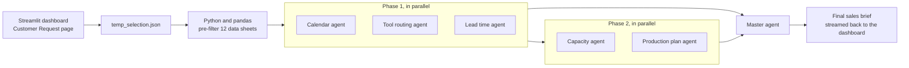

# Multi-Agent Order Feasibility System

Built at the **SDU AI Hackathon (April 2026)** for a predictive manufacturing case set by Danfoss.

A sales team gets a customer request (materials, quantities, preferred plant, delivery date) and needs to know quickly whether the factory network can deliver it. Today that check is done by hand across a dozen Excel sheets. This prototype answers it in two complementary ways:

1. **A deterministic feasibility engine** that ranks open orders and checks inventory, capacity and lead time for each material.
2. **A multi-agent LLM system** in which five specialist agents each analyse one part of the problem in parallel, and a master agent combines their reports into one sales brief.

Everything runs behind a Streamlit dashboard.

## Architecture



| Phase | Agents | Why |
|---|---|---|
| 1 | Calendar, Tool routing, Lead time | Independent of each other, so they run concurrently |
| 2 | Capacity, Production plan | Need the work centres, machine hours and target weeks from phase 1 |
| 3 | Master | Reads all five reports and writes one decision brief for sales |

### Design choices

- **One role per agent.** Each agent has its own instruction file in [`agents/`](agents/), with the data it owns, the steps to follow and a fixed output format. This keeps prompts short, makes each agent easy to test on its own and keeps the roles under version control.
- **Context is pre-filtered in code, not by the model.** Some sheets are large (the capacity sheet is about 2,500 rows by 194 columns and the operations plan about 30,000 rows). Python and pandas cut each sheet down to the rows for the requested materials and plant before they reach an agent, which keeps token use low and answers grounded in the data.
- **Agents are read-only.** All data arrives inside the prompt, so the agents need no file or shell access and run in plain `--print` mode.
- **Parallel where possible.** Agents without dependencies run at the same time with a thread pool, which cuts total run time.

## Deterministic feasibility engine

[`dashboard/pages/pipeline.py`](dashboard/pages/pipeline.py) runs without any LLM:

- **Order ranking.** A composite score of closing probability (50%), revenue tier (30%) and customer loyalty (20%).
- **Feasibility in rank order.** Higher-ranked orders consume inventory first, so lower-ranked orders see what is really left.
- **Capacity risk.** Work centres are flagged as moderate above 80% utilisation and critical above 95%.
- **Two fulfilment options per material.** It compares shipping from stock across plants with producing at the preferred plant, each with a delivery date and cost.

## Repository layout

```
agents/                  instruction files for the five specialist agents
scripts/run_analysis.py  multi-agent orchestration (phases 1 to 3)
scripts/extract_sheets.py  splits the Excel workbook into per-sheet CSV and JSON
dashboard/app.py         Streamlit entry point
dashboard/pages/         Sales dashboard, Customer request, Order feasibility, pipeline engine
data/                    anonymised dataset supplied by the case owner
```

## Running it

Requirements: Python 3.10 or newer and the [Claude Code CLI](https://docs.claude.com/en/docs/claude-code) installed and signed in (used by the agents).

```bash
python -m venv .venv
source .venv/bin/activate        # Windows: .venv\Scripts\activate
pip install -r requirements.txt

# dashboard
streamlit run dashboard/app.py

# or the agents alone, using the request in temp_selection.json
python scripts/run_analysis.py
```

If the `claude` command is not on your PATH, point to it with an environment variable:

```bash
export CLAUDE_BIN=/path/to/claude          # Windows: set CLAUDE_BIN=C:\path\to\claude.exe
```

## Data

The dataset is an anonymised export supplied by the case owner, with the same structure as the real production data (15 plants, 12 sheets). See [CASE_BRIEF.md](CASE_BRIEF.md) for the problem, [DATA_DICTIONARY.md](DATA_DICTIONARY.md) for the columns and joins, and [STARTER_PACK.md](STARTER_PACK.md) for the original hackathon instructions.
